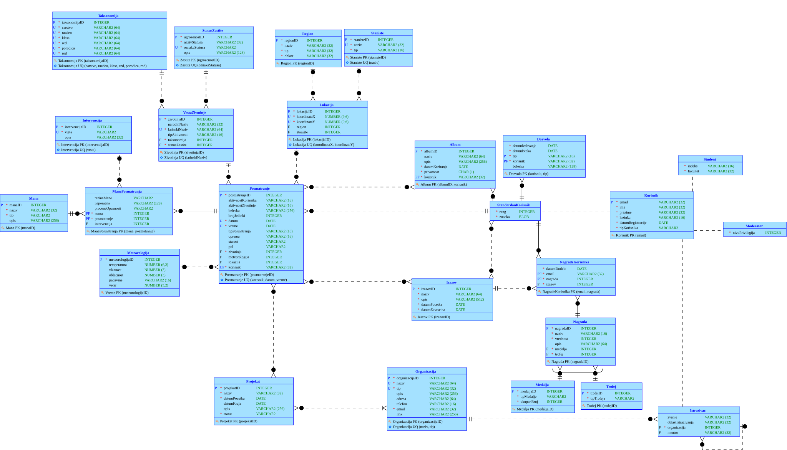
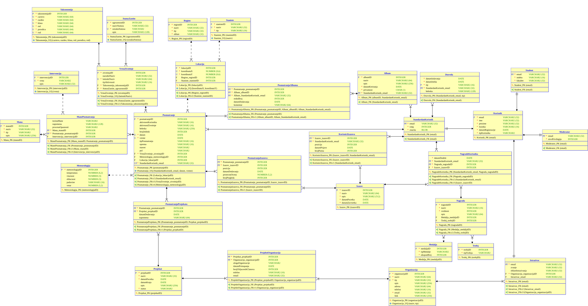

# Veles - Wildlife Observation Database

*A database design for a wildlife observation and conservation platform in Serbia.*

Veles started as an idea for an application where people interested in nature could record wildlife sightings, while researchers could use those observations to study species, habitats, and changes in animal populations. I wanted it to be more than a list of animals and their locations, so the concept also includes research projects, user collections, challenges, and rewards for contributing observations.

I developed the **data model** for this idea as an individual university project for the **Databases** course at the Faculty of Technical Sciences, University of Novi Sad. The assignment focused on designing an information system's database, from its conceptual model to a relational schema and SQL scripts. **The application itself was not implemented.**

The name *Veles* was inspired by the Slavic deity associated with animals, forests, and nature.

## How the idea started

I've been interested in animals for as long as I can remember, and I also love paleontology, dinosaurs, and fossils. My first thought was actually to come up with something related to discovering fossils. As I read more about Serbia's geological history, including the ancient seas that once covered much of its territory, I started thinking instead about all the living wildlife that people encounter here every day.

When I was a kid growing up in a village, I would often find an insect or some other small animal and have no idea what it was. It wasn't always easy to identify it or find reliable information about it. I later learned that some animals I had thought of as completely ordinary were actually protected species. That stuck with me. I liked the idea of encouraging people to go outside, notice the little things around them, take a photo, learn what they had found, and add it to a personal collection. A bit like filling out a Pokedex, except with real animals that you observe rather than catch.

I also thought those observations could be useful beyond the person who made them. With proper identification and verification, sightings from villages and other inhabited areas could help researchers and conservation organizations notice species in places they might not otherwise survey. A real application would need to handle sensitive wildlife locations carefully, but that combination of curiosity, collecting, and contributing to research is what inspired Veles. This database project was the first step in exploring the idea.

## The idea behind Veles

The proposed platform would bring together nature enthusiasts, students, researchers, and organizations interested in wildlife in Serbia. Its central activity is recording an observation: who saw an animal, which species it was, where and when it was seen, and what conditions were present.

The database was designed to support several connected parts of that idea:

- **Wildlife and conservation:** animal species, scientific taxonomy, conservation status, habitats, and geographical regions.
- **Observations:** recorded sightings with dates, locations, weather, animal behavior, number of individuals, and other details.
- **Animal welfare:** observed illnesses or injuries, along with possible interventions related to particular sightings.
- **Research:** organizations, researchers, projects, and observations associated with research work.
- **Community features:** different user roles, personal albums of observations, challenges, points, medals, and trophies.

These are features represented by the **database design**, not functioning screens or services in a completed application.

## Data models

I created the diagrams in **Oracle SQL Developer Data Modeler**. The logical model describes the main concepts and their relationships; the relational model shows how those concepts become tables, keys, and constraints.

### Logical (ER) model



[Open the full-size logical diagram](docs/images/Logical.svg)

The central entity is `Posmatranje` (Observation), which connects an animal species to a user and can also reference a location, meteorological conditions, and related research or community activities. The model also includes specializations of users and rewards, as well as associations between observations, albums, challenges, and projects.

### Relational model



[Open the full-size relational diagram](docs/images/Relational_1.svg)

The translation from the logical model includes dedicated tables for user roles and association tables for many-to-many relationships. The exported relational schema contains **30 tables**, with primary keys, foreign keys, unique constraints, and checks for selected attribute values.

## What is included

The repository contains the actual database modeling work rather than an application prototype:

- **25 logical entities** in the original data model.
- **30 relational tables** generated for the SQL schema.
- **34 foreign key definitions** and **15 `CHECK` constraints** in the DDL script.
- **315 `INSERT` statements** providing sample data for the modeled domain.
- The editable **Oracle SQL Developer Data Modeler project** and a **21-page report in Serbian** documenting the domain, entities, attributes, relationships, and relational translation.

The SQL uses Oracle-specific syntax such as `VARCHAR2` and Oracle date literals. The DDL was generated with Oracle SQL Developer Data Modeler targeting **Oracle Database 11g**.

## Exploring the project

You can examine both diagrams directly in this README without installing anything. For the detailed explanations and design decisions, see the [project documentation (PDF, Serbian)](docs/Dokumentacija.pdf).

To open and edit the original model, use **Oracle SQL Developer Data Modeler** and open [`model/VelesER.dmd`](model/VelesER.dmd). Keep the accompanying `model/VelesER/` directory in place because it contains the model's supporting files.

If you have access to a compatible Oracle database and want to work with the SQL scripts, use them in this order:

1. [`sql/Veles-DDL.ddl`](sql/Veles-DDL.ddl) - creates the tables and their constraints.
2. [`sql/VelesPodaci.sql`](sql/VelesPodaci.sql) - inserts sample records into the schema.

The repository does not include a running database server or a finished client application. The scripts are included as the output of the modeling assignment, not as a separately packaged or automated deployment.

## Repository structure

```text
Veles-Wildlife-Database/
├── model/
│   ├── VelesER.dmd             # Oracle Data Modeler design file
│   └── VelesER/               # Supporting model files
├── sql/
│   ├── Veles-DDL.ddl          # Tables and database constraints
│   └── VelesPodaci.sql        # Sample data
├── docs/
│   ├── Dokumentacija.pdf      # Original project report (Serbian)
│   └── images/
│       ├── Logical.svg        # Logical ER diagram
│       └── Relational_1.svg   # Relational diagram
├── .gitattributes
├── .gitignore
└── README.md
```

## A few notes

This was a database modeling assignment, not the development of the full Veles application. I kept the original model, generated SQL, and documentation because they capture a concept I would still find interesting to build into a real project someday.

The sample data is intended for demonstrating the schema. The database design should be viewed as an educational project, not as a production-ready system for handling real wildlife observations or user accounts.
